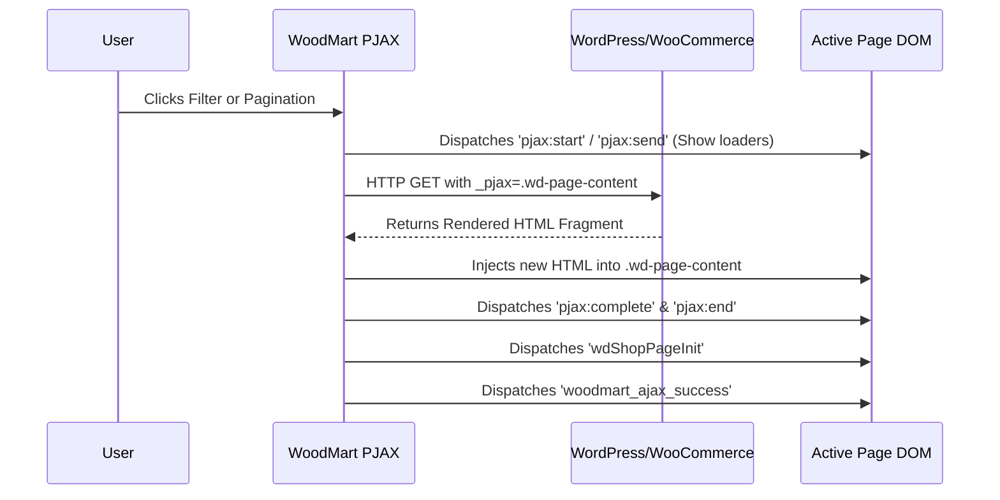

# 02 - WoodMart AJAX Shop & PJAX Lifecycle

## The PJAX Engine
WoodMart replaces standard full-page reloads on the shop page with HTML5 PushState + AJAX (PJAX).

### Request Signature
When a customer clicks pagination or native filter widgets, WoodMart intercepts the event and executes a request:
```http
GET /shop/?filter_color=black&paged=2&_pjax=.wd-page-content HTTP/1.1
Host: example.com
X-PJAX: true
X-PJAX-Container: .wd-page-content
```

### Response Processing
- The server processes the WooCommerce archive query and renders the page.
- On receipt, the client-side PJAX driver extracts the DOM elements inside `.wd-page-content` from the returned HTML and injects them into the current document's `.wd-page-content`.
- The browser URL is updated via `window.history.pushState()`.

## Event Dispatch Lifecycle
Understanding the event sequence is mandatory to prevent broken widgets or zombie event listeners:



## How to Harmonize Custom Plugins with WoodMart PJAX
1. **Event Delegation**:
   Always attach event handlers to `document` rather than loop items:
   ```javascript
   // BAD: Will stop working after first AJAX pagination
   $('.my-custom-button').on('click', function() { ... });

   // GOOD: Remains active across all PJAX updates
   $(document).on('click', '.my-custom-button', function() { ... });
   ```

2. **Idempotent Component Initialization**:
   ```javascript
   function initCustomBadges() {
       $('.my-product-card:not([data-badge-initialized])').each(function() {
           var $card = $(this);
           $card.attr('data-badge-initialized', 'true');
           // Initialize tooltip, animation, or custom price calculation
       });
   }

   $(document).ready(initCustomBadges);
   $(document).on('pjax:complete wdShopPageInit woodmart_ajax_success', initCustomBadges);
   ```

3. **Preventing Double AJAX Requests**:
   If a custom filter plugin handles AJAX queries, disable WoodMart native AJAX shop in `Theme Settings -> Shop -> AJAX Shop` to eliminate duplicate background fetches and race conditions.
