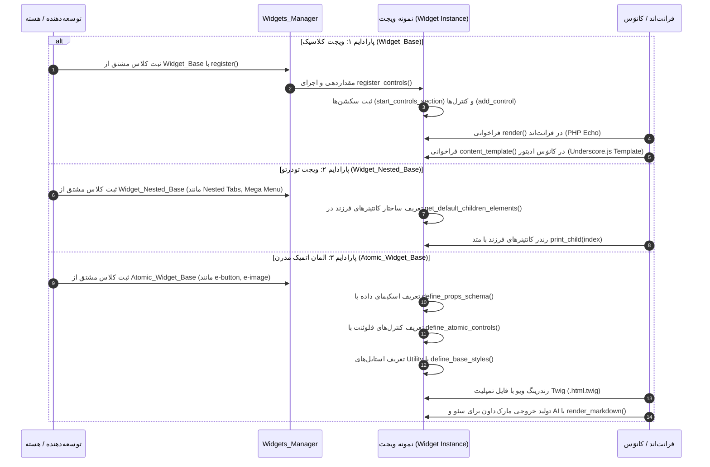
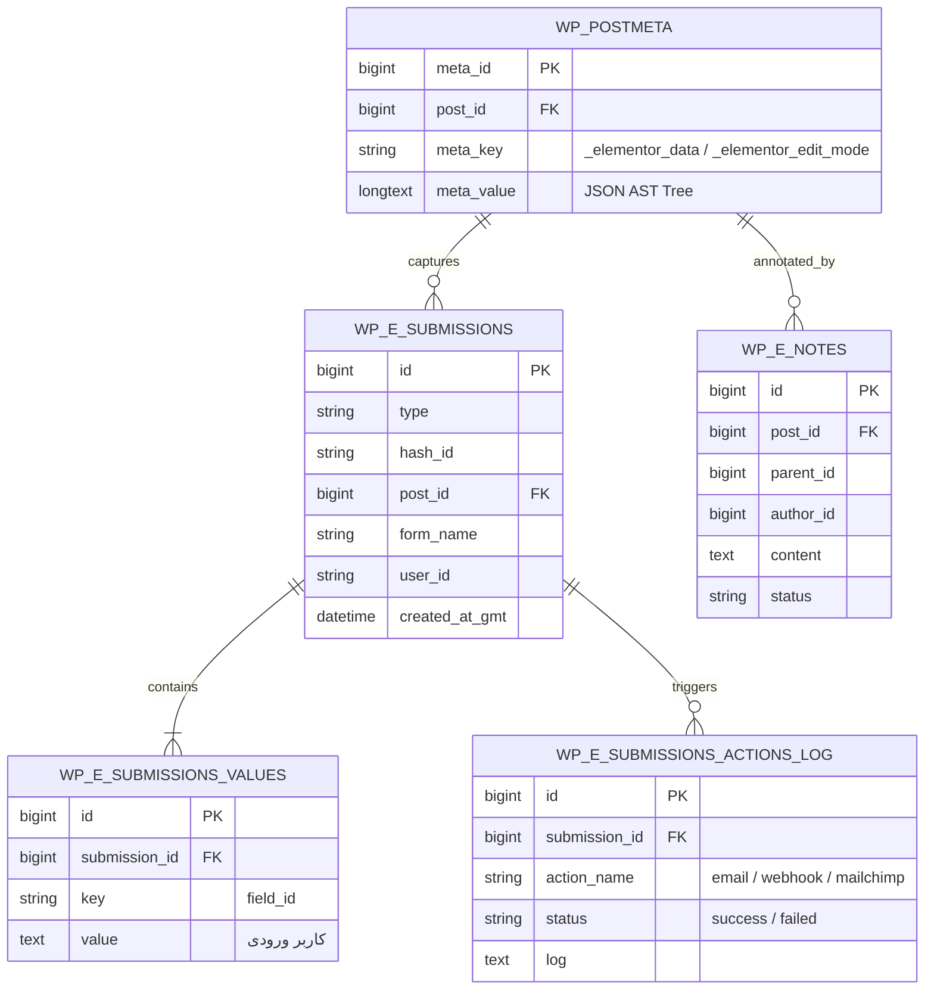
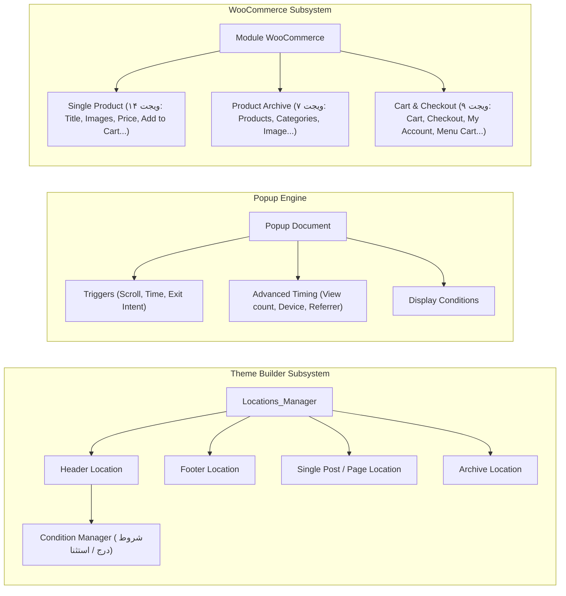

# گراف مهندسی صفر تا صد Elementor Core و Elementor Pro (0-to-100 Architecture Graph)

این سند نقشه کامل، یکپارچه و گام‌به‌گام عملکرد دو افزونه **Elementor Core (4.2.3)** و **Elementor Pro (4.3.2)** از لحظه اجرای نخستین خط کد در وردپرس تا رندر نهایی در مرورگر و چرخه حیات ادیتور زنده است.

---

## ۱. گراف کلان صفر تا صد چرخه حیات سیستم (Macro Lifecycle Graph)

```mermaid
flowchart TD
    %% فاز صفر و یک: بوت‌استرپ هسته
    subgraph Phase0["فاز ۰ و ۱: بوت‌استرپ و مقداردهی اولیه هسته (Bootstrap)"]
        WP_Boot["۱. وردپرس: فراخوانی هوک plugins_loaded"] --> Core_Entry["۲. elementor.php"]
        Core_Entry --> Core_EnvCheck{"۳. اعتبارسنجی PHP >= 7.4 و WP >= 6.8"}
        Core_EnvCheck -- تایید --> Core_Autoload["۴. ثبت Autoloader فضای نام Elementor\\"]
        Core_Autoload --> Core_Singleton["۵. نمونه‌سازی Plugin::instance()"]
        Core_Singleton --> Core_Managers["۶. مقداردهی ۴۰+ منیجر هسته (controls, widgets, elements, documents, etc.)"]
        Core_Managers --> Core_Modules["۷. بارگذاری ۶۴ ماژول مستقل هسته (atomic-widgets, nested-elements, etc.)"]
        Core_Modules --> Core_InitAction["۸. فعال‌سازی اکشن elementor/init"]
    end

    %% فاز دو: بوت‌استرپ المنتور پرو
    subgraph Phase1["فاز ۲: بوت‌استرپ المنتور پرو (Elementor Pro Bootstrap)"]
        Core_InitAction --> Pro_Entry["۹. elementor-pro.php"]
        Pro_Entry --> Pro_ReqCheck{"۱۰. بررسی نسخه هسته >= 4.0"}
        Pro_ReqCheck -- تایید --> Pro_Singleton["۱۱. نمونه‌سازی ElementorPro\\Plugin::instance()"]
        Pro_Singleton --> Pro_LicenseCheck["۱۲. بررسی وضعیت لایسنس و فعال‌سازی"]
        Pro_LicenseCheck --> Pro_Modules["۱۳. بارگذاری ۶۸ ماژول اختصاصی پرو (theme-builder, forms, popup, woocommerce, etc.)"]
    end

    %% فاز سه: ثبت رجیستری‌ها
    subgraph Phase2["فاز ۳: ثبت رجیستری‌ها و هوک‌های گسترش (Registration Bus)"]
        Pro_Modules --> Reg_Controls["۱۴. اکشن elementor/controls/register (۴۲+ کنترل و ۸ گروه کنترل)"]
        Reg_Controls --> Reg_Widgets["۱۵. اکشن elementor/widgets/register (۱۵۷ ویجت و المان اتمیک)"]
        Reg_Widgets --> Reg_Docs["۱۶. اکشن elementor/documents/register (انواع سند: page, header, popup, loop)"]
        Reg_Docs --> Reg_Tags["۱۷. اکشن elementor/dynamic_tags/register (۵۸ تگ داینامیک)"]
        Reg_Tags --> Reg_Locations["۱۸. اکشن elementor/theme/register_locations (موقعیت‌های قالب)"]
        Reg_Locations --> Router_Check{"۱۹. تشخیص نوع درخواست ورودی"}
    end

    %% فاز چهارم: انشعاب مسیرها
    subgraph Phase3A["مسیر A: فرانت‌اند و مشاهده کاربر عادی"]
        Router_Check -- "درخواست صفحه عمومی" --> FE_TemplateHook["۲۰. فیلتر template_include یا the_content"]
        FE_TemplateHook --> FE_DocInit["۲۱. بازیابی سند: Plugin::$instance->documents->get(id)"]
        FE_DocInit --> FE_CSSCheck["۲۲. پست سی‌اس‌اس: خواندن یا تولید uploads/elementor/css/post-id.css"]
        FE_CSSCheck --> FE_ASTLoop["۲۳. پیمایش بازگشتی درخت JSON از متای _elementor_data"]
        FE_ASTLoop --> FE_RenderNodes["۲۴. اجرای before_render -> render -> after_render روی تک‌تک عناصر"]
        FE_RenderNodes --> FE_AssetsQueue["۲۵. انکیو شرطی است‌های مورد نیاز ویجت‌ها (Swiper, Waypoints, etc.)"]
        FE_AssetsQueue --> FE_HTMLOut["۲۶. ارسال کد HTML نهایی و لینک‌های CSS به مرورگر"]
        FE_HTMLOut --> FE_JSRuntime["۲۷. اجرای frontend.js و فعال‌سازی هوک frontend/element_ready/..."]
    end

    subgraph Phase3B["مسیر B: ویرایشگر زنده (Live Editor Sandbox)"]
        Router_Check -- "پارامتر action=elementor" --> Ed_TopWindow["۲۸. لود فریم ادمین Top Window (رابط React، نوار بالا و نویگیتور)"]
        Ed_TopWindow --> Ed_Iframe["۲۹. باز کردن Preview Iframe (کانوَس زنده سایت)"]
        Ed_Iframe --> Ed_SyncLoop["۳۰. پروتکل تبادل بی‌درنگ PostMessage بین کنترل‌ها و پیش‌نمایش کلاینت"]
        Ed_SyncLoop --> Ed_LiveRender["۳۱. اعمال استایل زنده اینلاین یا رندر با تمپلیت Underscore.js / Twig"]
        Ed_LiveRender --> Ed_SaveAction["۳۲. فشردن دکمه انتشار -> ارسال ایجکس save_builder به سرور"]
        Ed_SaveAction --> DB_SaveAST["۳۳. ذخیره آرایه بازطراحی‌شده در متای _elementor_data و بازتولید فایل CSS"]
    end

    subgraph Phase3C["مسیر C: ایجکس و اندپوینت‌های REST Data V2"]
        Router_Check -- "درخواست admin-ajax یا wp-json" --> Ajax_Handler["۳۴. هندلر متمرکز elementor_ajax (۴۸ اکشن رجیستر شده)"]
        Ajax_Handler --> Ajax_ActionSelect{"۳۵. انتخاب اکشن"}
        Ajax_ActionSelect -- "render_widget" --> Ajax_Render["رندر مجدد HTML ویجت برای ادیتور"]
        Ajax_ActionSelect -- "save_builder" --> DB_SaveAST
        Ajax_ActionSelect -- "form_submissions" --> DB_SubmissionsTable["۳۶. ذخیره اطلاعات لید در جدول wp_e_submissions"]
    end
```

---

## ۲. گراف تفصیلی موتور لایه‌بندی و کامپوننت‌ها (Layout Architecture)

```mermaid
graph TD
    subgraph ClassicLayout["چیدمان سنتی کلاسیک (V1/V2 - DOM سنگین)"]
        Sec["Element_Section (.elementor-section)"] --> Col["Element_Column (.elementor-column)"]
        Col --> Wrap[".elementor-widget-wrap"]
        Wrap --> Wid["Widget_Base (.elementor-widget)"]
        Wrap --> InSec["Inner Section (تودرتو)"]
    end

    subgraph ContainerLayout["چیدمان منعطف کانتینر (V3 - Flexbox & Grid)"]
        ContRoot["Container (.e-con-boxed / .e-con-full)"] --> ContChild["Nested Container (.e-con)"]
        ContRoot --> CWid1["Widget"]
        ContChild --> CWid2["Widget"]
    end

    subgraph AtomicLayout["چیدمان اتمیک نسل ۴ (V4 - Ultra Lightweight)"]
        DivBlock["e-div-block (بلوک خالص div)"] --> AtomFlex["e-flexbox"]
        DivBlock --> AtomGrid["e-grid"]
        AtomFlex --> AtomWidget["Atomic Widgets (e-button, e-heading, etc.)"]
        AtomGrid --> AtomComponent["e-component (کامپوننت‌های ماژولار)"]
    end
```

---

## ۳. گراف سه پارادایم توسعه ویجت و رندرینگ (Widget Engine Paradigms)

---

## ۴. گراف پایگاه داده و ذخیره‌سازی لیدها و یادداشت‌ها (Data Schema)

---

## ۵. گراف پوسته ساز، پاپ‌آپ و فروشگاه‌ساز ووکامرس (Theme & E-Commerce)

