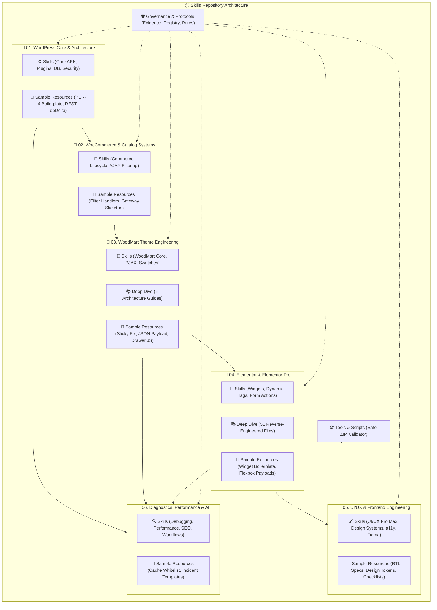
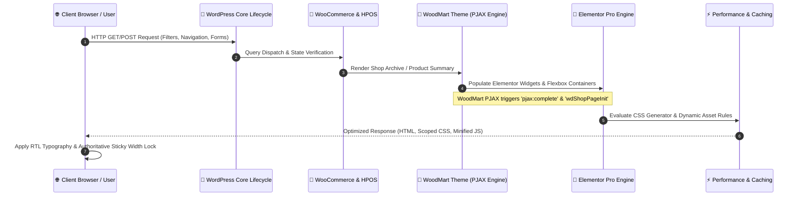
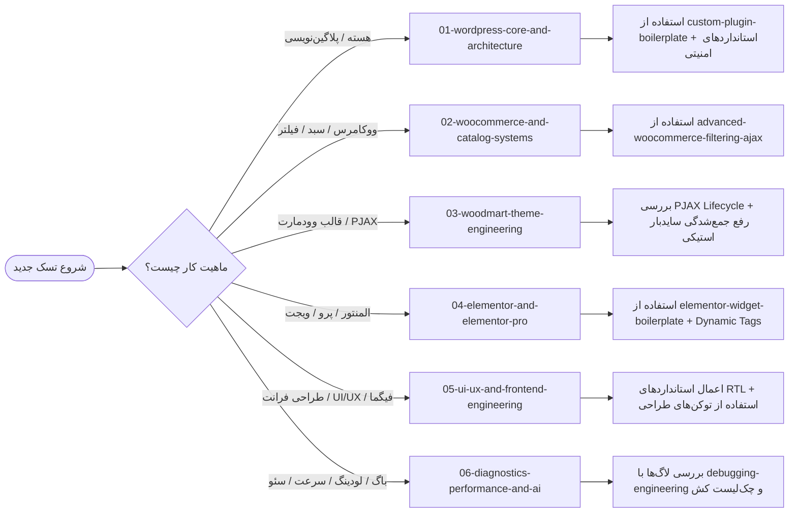

# ⚡ Comprehensive AI Agent Skills & Engineering Repository
## مخزن جامع و دسته‌بندی‌شده اسکیل‌های مهندسی وردپرس، ووکامرس، المنتور، وودمارت، UI/UX، سئو فارسی و فول‌استک

این مخزن شامل پکیج کامل، فوق‌حرفه‌ای و استاندارد از **۴۸ اسکیل هوش مصنوعی** در **۸ دسته‌بندی اصلی**، پایگاه‌های دانش معماری عمیق، پروتکل‌های حاکمیت کد و **ریسورس‌های نمونه کاربردی (Sample Resources)** است که به صورت دقیق دسته‌بندی شده و در کنار هر اسکیل قرار گرفته‌اند.

---

## 🗺️ Master Architecture Graph (گراف معماری کلان سیستم)

دیاگرام زیر ارتباط لایه‌های ۶گانه مهندسی، اسکیل‌ها و ریسورس‌های نمونه را نمایش می‌دهد:



---

## 🔄 Full Lifecycle Execution Graph (چرخه اجرای درخواست‌ها)

این گراف نحوه تعامل یک رکوئست یا فیچر را در پشته کامل وردپرس، ووکامرس، وودمارت و المنتور پرو نشان می‌دهد:



---

## 🗂️ دسته‌بندی تفصیلی مخزن (Repository Directory Breakdown)

### 📂 `01-wordpress-core-and-architecture/`
توسعه زیرساخت، معماری پایگاه داده، امنیت هسته و استانداردسازی پلاگین‌نویسی وردپرس.
- **Skills:**
  - `wordpress-development-architecture`: چرخه حیات درخواست، ترنزینت‌ها، کران و هوک‌ها.
  - `custom-wordpress-plugin-engineering`: معماری ماژولار و تفکیک دامنه‌های اختصاصی.
  - `wordpress-plugin-development`: پیاده‌سازی مدرن شیءگرا با استاندارد PSR-4.
  - `database-data-architecture`: مدل‌های داده، مایگریشن و بهینه‌سازی جداول دیتابیس.
  - `wordpress-security-engineering`: نانس‌ها، سطوح دسترسی (Capabilities) و امن‌سازی اندپوینت‌ها.
  - `server-deployment-engineering`: محیط‌های استیجینگ، بکاپ‌گیری و ابزارهای خط فرمان WP-CLI.
  - `software-architecture-code-governance`: ثبت سوابق تصمیمات معماری (ADR) و کنترل کیفیت.
  - `edit-wordpress-block-content`: کار تخصصی با ساختار بلاک‌های گوتنبرگ.
  - `publish-wordpress-content`: انتشار و ساختاردهی خودکار نوشته‌ها و تاکسونومی‌ها.
  - `manage-wordpress-com-sites`: مدیریت و کانفیگ سایت‌های متصل.
- **Sample Resources (کنار اسکیل‌ها):**
  - `custom-plugin-boilerplate/`: بویلرپلیت کامل و آماده افزونه وردپرس با لایه‌بندی مدرن.
  - `rest-api-controller-example.php`: کنترلر استاندارد و ایمن REST API وردپرس.
  - `custom-table-dbdelta-migration.php`: مایگریشن صحیح جداول سفارشی با تابع `dbDelta`.
  - `hpos-compatibility-declaration.php`: نمونه کد استاندارد اعلام سازگاری با سفارشات سریع ووکامرس (HPOS).

---

### 📂 `02-woocommerce-and-catalog-systems/`
فروشگاه، چرخه سفارشات، مدیریت پرداخت و فیلترهای ایجکس کاتالوگ.
- **Skills:**
  - `woocommerce-engineering`: چرخه سبد خرید، تسویه، درگاه‌های پرداخت، انبار و HPOS.
  - `advanced-woocommerce-filtering-ajax`: کوئری‌های ترکیبی تاکسونومی و ایجکس کاتالوگ.
- **Sample Resources (کنار اسکیل‌ها):**
  - `ajax-catalog-filter/`: پکیج کامل هندلر بک‌اند PHP و اسکریپت کلاینت JS فیلتر ایجکس.
  - `custom-payment-gateway-sample.php`: ساختار کامل پیاده‌سازی کلاس درگاه پرداخت اختصاصی.

---

### 📂 `03-woodmart-theme-engineering/`
مهندسی تخصصی قالب وودمارت، کنترل چرخه PJAX، دراور موبایل و بهینه‌سازی.
- **Skills:**
  - `woodmart-theme-engineering`: هماهنگی کامل هوک‌ها، تنظیمات وودمارت، سوئیچ‌ها و خرید چسبان.
- **Knowledge Deep Dive (راهنماهای جامع معماری):**
  - `01-WOODMART-ARCHITECTURE-AND-CORE.md`: ساختار والد، چایلدتم و هسته WoodMart Core.
  - `02-WOODMART-AJAX-SHOP-AND-PJAX.md`: تحلیل رفتار `_pjax=.wd-page-content` و هوک‌های ایجکس.
  - `03-WOODMART-ELEMENTOR-INTEGRATION.md`: ویجت‌های اختصاصی `wd_products` و کانتینرها.
  - `04-WOODMART-FILTERS-AND-OFFCANVAS.md`: مدیریت منوی کشویی و دراور آف‌کانواس موبایل.
  - `05-WOODMART-WOOCOMMERCE-ECOSYSTEM.md`: سوئیچ‌های متغیر، پیش‌نمایش سریع (Quick View) و علاقه‌مندی‌ها.
  - `06-WOODMART-PERFORMANCE-AND-ASSETS.md`: بهینه‌ساز CSS، لودینگ ماژولار و فونت‌های محلی.
- **Sample Resources (کنار اسکیل‌ها):**
  - `wd_sample_products_widget.json`: پی‌لود واقعی ویجت محصولات وودمارت با تم تاریک و اسلایدر.
  - `woodmart-pjax-reinit-handler.js`: کنترلر ایجکس و پی‌جکس برای لایف‌سایکل المنتور و وودمارت.
  - `sticky-sidebar-flexbox-fix.css`: استایل دفاعی رفع باگ چروکیدگی سایدبار استیکی در المنتور.
  - `mobile-offcanvas-drawer-controller.js`: اسکریپت اختصاصی مدیریت دراور فیلتر در موبایل.

---

### 📂 `04-elementor-and-elementor-pro/`
ساخت افزونه‌ها، ویجت‌ها، اکشن‌های فرم و تگ‌های پویای المنتور و المنتور پرو.
- **Skills:**
  - `elementor-architecture`: معماری سورس-محور Core v4.2.3 و Pro v4.3.2، گراف 0-to-100، کاتالوگ کامل ویجت‌ها (Classic/Nested/Atomic V4 `e-*`)، ۱۲ رول‌بوک دسته‌بندی‌شده، AST/MCP و ابزارهای CLI (`inspect_widget.py`، `article_to_elementor.py`).
  - `elementor-pro-engineering`: توسعه Theme Builder، تگ‌های پویا، اکشن‌های فرم و لوپ‌بیلدر.
  - `elementor-theme-integration`: سازگاری چیدمان کانتینرهای فلکس‌باکس و عدم تداخل استایل‌ها.
- **Knowledge Deep Dive (۵۱ فایل معکوس‌شده):**
  - پوشه‌های `CONTROLS`، `DESIGN-SYSTEM`، `EVIDENCE`، `IMPLEMENTATION`، `INTEGRATIONS`، `SOURCE-ANALYSIS`، `TESTING` و `WIDGETS`.
- **Sample Resources (کنار اسکیل‌ها):**
  - `class-custom-product-card-widget.php`: کلاس کامل ساخت ویجت سفارشی با کنترل‌های حرفه‌ای.
  - `class-custom-form-webhook-action.php`: اکشن اختصاصی بعد از ارسال فرم المنتور برای ارسال به وب‌هوک.
  - `class-custom-product-brand-tag.php`: تگ پویای متنی اختصاصی المنتور پرو.
  - `clean_elementor.json` و `final_elementor_data.json`: پی‌لودهای واقعی ساختار داده کانتینرها.
  - `accordion_sample.json`: نمونه ساختار دیتای ویجت آکاردئون المنتور.

---

### 📂 `05-ui-ux-and-frontend-engineering/`
سیستم‌های طراحی، هوش طراحی UI/UX، دسترسی‌پذیری و ابزارهای رابط کاربری.
- **Skills (۲۳ اسکیل):**
  - `design-master`: موتور یکپارچه ۱۰ماژوله UI/UX و طراحی گرافیک شامل دیتابیس جستجوی BM25 (۷۹ سبک، ۱۹۲ پالت، ۷۴ جفت فونت، ۱۱۹ قانون UX)، فیلتر ضد AI-Slop، توکن‌های ۳لایه، Tailwind v4 + shadcn/ui، استودیوی هویت بصری (۵۵ لوگو / ۵۰ CIP / ۱۵ آیکون SVG)، موتور اسلاید HTML با ۸ CSV، بنر/کانواس، WCAG 2.2، UX موبایل و Figma-to-Code.
  - `frontend-engineering`: استانداردهای چیدمان، CSS مدرن و پشتیبانی دوطرفه راست‌چین (RTL).
  - `ui-ux-pro-max`: هوش جامع طراحی، پالت‌های رنگی، مقیاس تایپوگرافی و توکن‌ها.
  - `frontend-design`: دیزاین منحصربه‌فرد فرانت‌اند (توسعه‌یافته توسط Anthropic).
  - `web-accessibility`: حسابرسی دسترسی‌پذیری وب مطابق استاندارد WCAG 2.2.
  - `web-design-guidelines`: راهنماهای اعتبارسنجی رابط کاربری ورسل (Vercel).
  - `taste-skill`: جهت‌دهی هنری و انتخاب تصاویر طبیعی برای صفحات فرود.
  - `superdesign`: کار با بوم طراحی سوپردیزاین.
  - `design-system`: مدیریت توکن‌های طراحی چند لایه و اتصال به تیل‌ویند.
  - `theme-factory`: ساخت و اعمال تم‌های رنگی و فونت‌های استاندارد.
  - `mobile-design`: استانداردهای طراحی اپلیکیشن‌های موبایل و ابعاد تاچ ۴۴ پیکسل.
  - `claude-design-skill`: ساخت پروتوتایپ‌های تعاملی و صفحات وب آرتیفکت.
  - `impeccable`: پالایش، ممیزی و بازبینی فرانت‌اند تولیدشده توسط هوش مصنوعی.
  - `shadcn-ui`: ترکیب و استایل‌دهی کامپوننت‌های مدرن shadcn.
  - `ui-styling`: استایل‌دهی پیشرفته تیل‌ویند، دارک‌مود و جلوه‌های بصری.
  - `web-artifacts-builder`: ساخت اپلیکیشن‌های تک‌فایلی مستقل ری‌اکت و تایپ‌اسکریپت.
  - `figma-mcp`: سرور رسمی اتصال مستقیم هوش مصنوعی به فایل‌های فیگما.
  - `figma-implement-design`: تبدیل فریم‌های فیگما به کد دقیق با انطباق ۱:۱.
  - `brand-guidelines`: دستورالعمل‌های یکپارچگی هویت بصری برند.
  - `banner-design`: طراحی بنرهای تبلیغاتی و لندینگ پیج.
  - `html-slides`: ساخت اسلایدهای ارائه تعاملی HTML با Chart.js.
  - `canvas-design`: طراحی پوستر و اسناد گرافیکی تک‌صفحه‌ای.
  - `algorithmic-art`: خلق الگوهای بصری و آرت‌های الگوریتمی با p5.js.
- **Sample Resources (کنار اسکیل‌ها):**
  - `rtl-typography-and-spacing.css`: استایل پایه فونت فارسی (وزیرمتن) و اینتر با چینش دقیق.
  - `sample-design-tokens.json`: ساختار کامل توکن‌های طراحی (رنگ، سایز، فاصله، فونت).
  - `wcag-accessibility-checklist.md`: چک‌لیست کاربردی طراحان و برنامه‌نویسان برای دسترسی‌پذیری.

---

### 📂 `06-diagnostics-performance-and-ai/`
عیب‌یابی پیشرفته، سئو تکنیکال، بهینه‌سازی سرعت و عملیات هوش مصنوعی.
- **Skills:**
  - `debugging-engineering`: ایزولاسیون دقیق باگ‌ها و رهگیری کال‌استک‌ها.
  - `performance-engineering`: ممیزی Core Web Vitals و بهینه‌سازی بارگذاری لایه‌ها.
  - `business-logic-workflow-automation`: جریان‌های تایید چندمرحله‌ای و مدیریت سطوح دسترسی.
  - `seo-technical-wordpress`: ساختار داده‌ای اسکیماهای فروشگاهی و سئو تکنیکال.
  - `ai-assisted-development`: پروتکل همکاری تیمی با ایجنت‌های هوش مصنوعی.
- **Sample Resources (کنار اسکیل‌ها):**
  - `caching-and-rucss-whitelist.md`: لیست سفید حذف CSS استفاده نشده و تاخیر جاوااسکریپت برای وودمارت.

---

### 📂 `07-seo-and-content-engineering/`
موتور کامل سئو فارسی، مهندسی محتوا، استراتژی کلاستر، رفرش جراحی، اسکیما و خروجی RTL Word.
- **Skills:**
  - `seo-master`: موتور جامع و Brand-Agnostic سئو فارسی شامل ۱۰ انجین (بلاگ UX-First v2، متادیتا/کنونیکال، استراتژی هاب-اسپوک، ممیزی ۱۰برابری و رفرش جراحی، کپی لندینگ/محصول، رپورتاژ و آف‌پیج PR، FAQ و JSON-LD، تحلیل UX محتوا، سئو محلی و سئو تکنیکال وردپرس) به همراه اسکریپت `scripts/md_to_docx.py`.

---

### 📂 `08-software-engineering-and-fullstack/`
مهندسی نرم‌افزار مدرن، تست خودکار، امنیت، مدیریت ایجنت و پشته React / Next.js / Supabase / PostgreSQL.
- **Skills:**
  - `engineering-master`: برنامه‌ریزی و Vertical Slicing، طراحی API/ADR، کدریویوی ۵محوره، TDD و تست مرورگر Playwright (`with_server.py`)، دیباگ ریشه‌ای، امنیت OWASP/STRIDE/LLM05، پرفورمنس CWV/RUM و Git/CI-CD.
  - `fullstack-web-master`: راهنمای رسمی Vercel React & Next.js (۷۲ قانون)، مهندسی پلتفرم Supabase و بهترین شیوه‌های PostgreSQL (۳۳ قانون عمیق).
  - `agent-workflow-master`: مهندسی کانتکست، Graphify، توسعه مبتنی بر سورس رسمی و بازبینی نقادانه (Doubt-Driven Review).

---

### 📂 `governance-and-protocols/`
قوانین بالادستی و استانداردهای مهندسی:
- `EVIDENCE-AND-CONFIDENCE.md`: سطوح اعتماد داده‌ها و جلوگیری از حدس‌زدن نام توابع یا گزینه‌ها.
- `PROJECT-CONTEXT-TEMPLATE.md`: قالب رسمی مستندسازی شناسنامه پروژه‌ها.
- `PROJECT-REGISTRY.md`: رجیستری پروژه‌ها برای ممانعت از ترکیب تنظیمات سایت‌های مختلف.
- `KNOWLEDGE-MAP.md`: نقشه وابستگی‌های متقابل دامنه‌های مهارتی.
- `UPDATE-PROTOCOL.md`: پروتکل مستندسازی اصلاحیه‌ها و یادگیری مداوم.
- `wordpress-engineering.md`: رول عملیاتی توسعه بدون خطای وردپرس.

---

### 📂 `tools/`
اسکریپت‌های پکیجینگ و اعتبارسنجی:
- `build_safe_zip.py`: ابزار تضمین‌شده پکیج کردن زیپ با اسلش رو به جلو (`/`) جهت رفع مشکل اکسترکت در هاست‌های لینوکسی وردپرس.
- `validate_all_skills.py`: اسکریپت اتوماتیک بررسی صحت و سلامت ۱۰۰٪ اسکیل‌ها در تمام دسته‌بندی‌ها.

---

## 🚦 Skill Routing Decision Tree (درخت تصمیم‌گیری انتخاب اسکیل)



---

## 🚀 نحوه اعتبارسنجی پکیج

برای اطمینان از سلامت تمامی ۴۸ اسکیل و فرانت‌مترها، دستور زیر را در خط فرمان اجرا کنید:
```bash
python tools/validate_all_skills.py
```
خروجی تایید ۱۰۰٪ سلامت تمام اسکیل‌ها را به صورت سبز و دسته‌بندی‌شده نمایش خواهد داد.
